# bitrl

_bitrl_ is a C++20 library for reinforcement learning. It has environments, among them grid worlds,
Connect2, multi-armed bandits, robots simulated in Chrono, and Gymnasium's environments over a REST API,
and the algorithms that learn in them, from dynamic programming to proximal policy optimization. Its deep
reinforcement learning uses <a href="https://pytorch.org/cppdocs/">libtorch</a>, the C++ API of PyTorch.
bitrl is built on <a href="https://github.com/pockerman/bitsim">bitsim</a>, a library for robots, and the
documentation of both is <a href="https://pockerman.github.io/bitsim_bitrl_docs/index.html">here</a>.

<table>
  <tr>
    <td width="50%">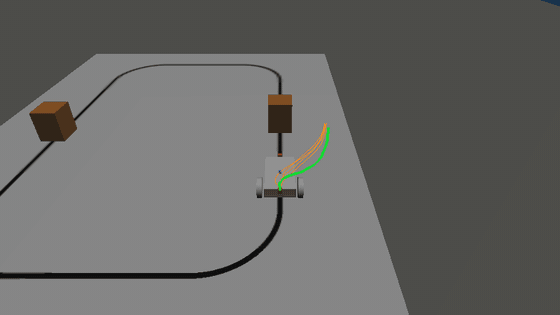</td>
    <td width="50%">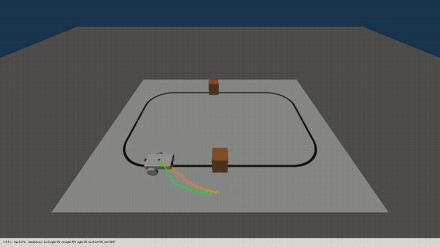</td>
  </tr>
  <tr>
    <td>Monte Carlo tree search drives bitsim's Chrono robot along a line and around boxes. Every 0.2 s it runs 400 simulations, 5 s ahead, in a fast model of the track. Each line is where one of the five commands leads; the robot takes the green one, and the wider an orange line, the more simulations tried its command. <a href="examples/10_robotics/mcts_line_following/mcts_line_following.md">Example</a></td>
    <td>With nothing but those plans the robot goes once around the track in 47.7 s, without touching a box, faster than bitsim's hand written controller; each decision takes about 4 ms. <a href="examples/10_robotics/mcts_line_following/mcts_line_following.md">Example</a></td>
  </tr>
</table>

## What is in it

| Area | What bitrl has |
| ---- | -------------- |
| Environments | grid worlds, Connect2, multi-armed bandits, GymWalk, bitsim robots in Chrono, and Gymnasium's FrozenLake, CliffWalking, Taxi, Blackjack, CartPole, MountainCar, Pendulum, Acrobot and LunarLander over the <a href="https://github.com/pockerman/bitrl-rest-api">bitrl-rest-api</a> server |
| Dynamic programming | iterative policy evaluation, policy iteration, value iteration |
| Monte Carlo | first visit Monte Carlo, Monte Carlo tree search |
| Temporal difference | SARSA, Q-learning, expected SARSA, double Q-learning |
| Policy gradients | REINFORCE, with and without a baseline, A2C, PPO |
| Policies | epsilon-greedy with decay, soft-max, greedy and uniform tabular policies |
| Tools | experience replay buffers, trainers, policies saved to and loaded from files, Tensorboard logging, PyTorch distributions and optimizers |

## Examples

The examples build on each other, from the basic ideas to deep reinforcement learning, and each has a page
that explains it. They are listed in [examples/examples.md](examples/examples.md). The Gymnasium
environments run on the <a href="https://github.com/pockerman/bitrl-rest-api">bitrl-rest-api</a> server.

### The basics

- <a href="examples/01_basics/monte_carlo_integration/monte_carlo_integration.md">Monte Carlo integration</a>
- <a href="examples/01_basics/importance_sampling/importance_sampling.md">Importance sampling</a>
- <a href="examples/01_basics/discounted_returns/discounted_returns.md">Discounted returns</a>
- <a href="examples/01_basics/markov_chain/markov_chain.md">A Markov chain</a>

### The PyTorch C++ API

- <a href="examples/02_pytorch/pytorch_tensors/pytorch_tensors.md">PyTorch tensors</a>
- <a href="examples/02_pytorch/pytorch_linear_regression/pytorch_linear_regression.md">Training a linear model</a>
- <a href="examples/02_pytorch/pytorch_custom_model/pytorch_custom_model.md">A custom model</a>
- <a href="examples/02_pytorch/pytorch_policy_network/pytorch_policy_network.md">A policy network: sampling actions and training on their log probabilities</a>
- <a href="examples/02_pytorch/cuda_vector_addition/cuda_vector_addition.md">Vector addition with CUDA</a>

### Experiments

- <a href="examples/03_experiments/export_policy/export_policy.md">Exporting a policy: a table to CSV, a network with libtorch</a>
- <a href="examples/03_experiments/log_experiment/log_experiment.md">Logging an experiment: settings, episodes, results and Tensorboard</a>
- <a href="examples/03_experiments/tensorboard/tensorboard.md">Logging to Tensorboard</a>

### Environments

- <a href="examples/04_environments/grid_world/grid_world.md">A grid world</a>
- <a href="examples/04_environments/connect2/connect2.md">Connect2</a>
- <a href="examples/04_environments/gymnasium_part_1/gymnasium_part_1.md">Gymnasium environments (part 1)</a>
- <a href="examples/04_environments/gymnasium_part_2/gymnasium_part_2.md">Gymnasium environments (part 2)</a>
- <a href="examples/04_environments/gymnasium_part_3/gymnasium_part_3.md">Gymnasium environments (part 3)</a>
- <a href="examples/04_environments/gym_walk/gym_walk.md">GymWalk</a>
- <a href="examples/04_environments/acrobot_vector_env/acrobot_vector_env.md">A vector environment: Acrobot</a>

### Algorithms

- <a href="examples/05_bandits/multi_armed_bandits/multi_armed_bandits.md">Multi-armed bandits: epsilon-greedy and Thompson sampling</a>
- <a href="examples/05_bandits/softmax_bandits/softmax_bandits.md">Multi-armed bandits with a soft-max policy</a>
- <a href="examples/06_dynamic_programming/iterative_policy_evaluation/iterative_policy_evaluation.md">Iterative policy evaluation on ```FrozenLake```</a>
- <a href="examples/06_dynamic_programming/policy_iteration/policy_iteration.md">Policy iteration on ```FrozenLake```</a>
- <a href="examples/06_dynamic_programming/value_iteration/value_iteration.md">Value iteration on ```FrozenLake```</a>
- <a href="examples/07_monte_carlo/first_visit_monte_carlo/first_visit_monte_carlo.md">First visit Monte Carlo on ```FrozenLake```</a>
- <a href="examples/08_temporal_difference/sarsa/sarsa.md">SARSA on ```CliffWalking```</a>
- <a href="examples/08_temporal_difference/q_learning/q_learning.md">Q-learning on ```CliffWalking```</a>
- <a href="examples/08_temporal_difference/expected_sarsa/expected_sarsa.md">Expected SARSA on ```CliffWalking```</a>
- <a href="examples/08_temporal_difference/double_q_learning/double_q_learning.md">Double Q-learning on ```CliffWalking```</a>
- <a href="examples/09_deep_rl/dqn/dqn.md">DQN on a grid world</a>
- <a href="examples/09_deep_rl/dqn_experience_replay/dqn_experience_replay.md">DQN with experience replay</a>
- <a href="examples/09_deep_rl/reinforce/reinforce.md">REINFORCE on ```CartPole```</a>
- <a href="examples/09_deep_rl/reinforce_baseline/reinforce_baseline.md">REINFORCE with a baseline on ```CartPole```</a>
- <a href="examples/09_deep_rl/a2c/a2c.md">A2C on ```CartPole```</a>
- <a href="examples/09_deep_rl/ppo_cartpole/ppo_cartpole.md">PPO on ```CartPole```</a>
- <a href="examples/09_deep_rl/ppo_lunar_lander/ppo_lunar_lander.md">PPO on ```LunarLanderContinuous```</a>

### The algorithms at work

Every algorithm example ends by showing what it learned. Each GIF links to its example.

<table>
  <tr>
    <td width="33%" align="center"><a href="examples/05_bandits/multi_armed_bandits/multi_armed_bandits.md">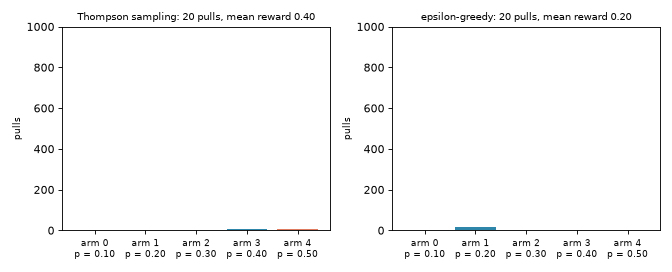</a><br>Thompson sampling and epsilon-greedy finding the best of five arms</td>
    <td width="33%" align="center"><a href="examples/05_bandits/softmax_bandits/softmax_bandits.md">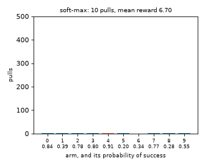</a><br>A soft-max policy on ten arms</td>
    <td width="33%" align="center"><a href="examples/06_dynamic_programming/iterative_policy_evaluation/iterative_policy_evaluation.md">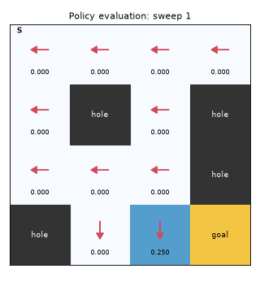</a><br>Iterative policy evaluation of the random policy on the slippery lake</td>
  </tr>
  <tr>
    <td width="33%" align="center"><a href="examples/06_dynamic_programming/policy_iteration/policy_iteration.md">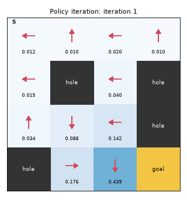</a><br>Policy iteration: the optimal policy in 4 iterations</td>
    <td width="33%" align="center"><a href="examples/06_dynamic_programming/value_iteration/value_iteration.md">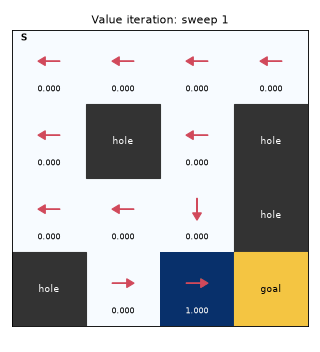</a><br>Value iteration: the values spread back from the goal in 7 sweeps</td>
    <td width="33%" align="center"><a href="examples/07_monte_carlo/first_visit_monte_carlo/first_visit_monte_carlo.md">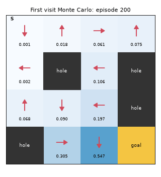</a><br>First visit Monte Carlo estimates of the same values from sampled episodes</td>
  </tr>
  <tr>
    <td width="33%" align="center"><a href="examples/08_temporal_difference/q_learning/q_learning.md">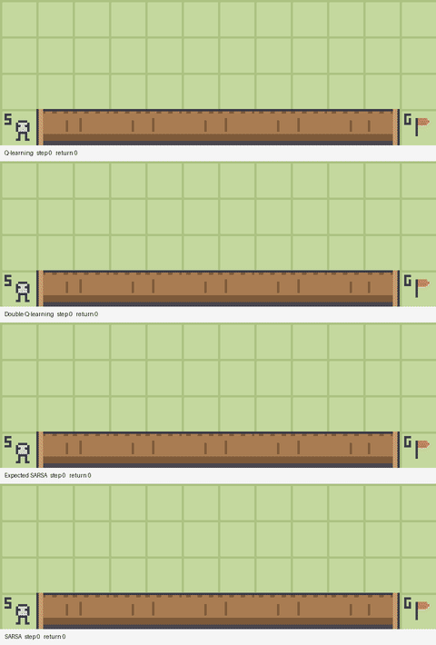</a><br>Q-learning, double Q-learning, expected SARSA and SARSA on CliffWalking</td>
    <td width="33%" align="center"><a href="examples/09_deep_rl/dqn/dqn.md">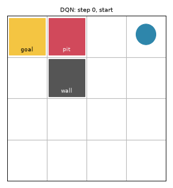</a><br>DQN: the shortest way around the wall and the pit</td>
    <td width="33%" align="center"><a href="examples/09_deep_rl/dqn_experience_replay/dqn_experience_replay.md">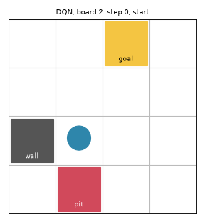</a><br>DQN with experience replay on random boards: 85 of 100 solved</td>
  </tr>
  <tr>
    <td width="33%" align="center"><a href="examples/09_deep_rl/reinforce/reinforce.md">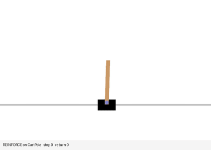</a><br>REINFORCE on CartPole: 126 steps</td>
    <td width="33%" align="center"><a href="examples/09_deep_rl/reinforce_baseline/reinforce_baseline.md">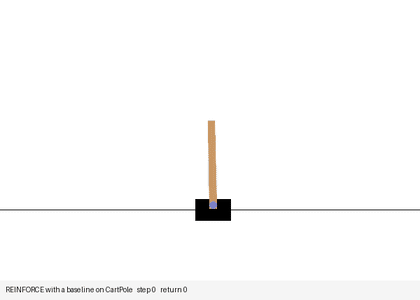</a><br>REINFORCE with a baseline: all 500 steps</td>
    <td width="33%" align="center"><a href="examples/09_deep_rl/a2c/a2c.md">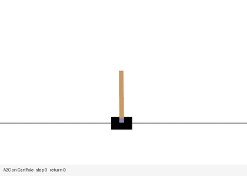</a><br>A2C: all 500 steps</td>
  </tr>
  <tr>
    <td width="33%" align="center"><a href="examples/09_deep_rl/ppo_cartpole/ppo_cartpole.md">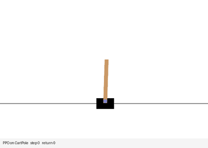</a><br>PPO: 339 steps</td>
    <td width="33%" align="center"><a href="examples/09_deep_rl/ppo_lunar_lander/ppo_lunar_lander.md">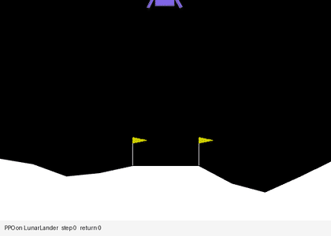</a><br>PPO on LunarLander: 9 of 10 landings</td>
  </tr>
</table>

### Robotics

These need _bitsim_ built with Chrono.

- <a href="examples/10_robotics/chrono_smc_system/chrono_smc_system.md">A Chrono system with smooth contacts</a>
- <a href="examples/10_robotics/chrono_rl_env/chrono_rl_env.md">A Chrono robot as an environment</a>
- <a href="examples/10_robotics/mcts_line_following/mcts_line_following.md">Following a line with Monte Carlo tree search</a>

## Installation

bitrl needs

- a compiler that supports C++20, for example g++ 11
- <a href="https://cmake.org/">CMake</a> 3.20 or later
- <a href="https://www.boost.org/">Boost</a> and <a href="https://eigen.tuxfamily.org/index.php?title=Main_Page">Eigen</a>
- <a href="https://github.com/gabime/spdlog">spdlog</a>, which bitsim logs with
- <a href="https://github.com/google/googletest">GoogleTest</a>, if it is built with the tests

HTTPRequest and nlohmann/json come with bitsim.

### bitsim and libtorch

bitrl is built on <a href="https://github.com/pockerman/bitsim">bitsim</a> 5, which has to be installed first, see its
<a href="https://github.com/pockerman/bitsim/blob/master/doc/install.md">install page</a>. bitsim installs as the CMake
package `bitsim`. bitrl also needs <a href="https://pytorch.org/get-started/locally/">libtorch</a>, built with the
C++11 ABI, and TBB (`sudo apt-get install libtbb-dev`). Tell CMake where bitsim and libtorch are:

```
cmake -B build -DCMAKE_PREFIX_PATH="/path/to/bitsim/prefix;/path/to/libtorch"
cmake --build build --parallel 3
```

Give `--parallel` a number. Files that include libtorch take a lot of memory to compile, and an unlimited
build runs out of memory on a 16 GB machine.

Add the Chrono prefix to `CMAKE_PREFIX_PATH` too if bitsim was built with Chrono and Chrono is not in a system prefix.
`ci/install_bitsim.sh` and `ci/install_libtorch.sh` do both installs the way CI does.

### Logging

bitrl logs with bitsim's logger, which writes with <a href="https://github.com/gabime/spdlog">spdlog</a> to standard
error. bitrl's messages go to the logger named `bitrl`, and are written with the stream operator:

```cpp
#include "bitrl/base/bitrl_log.h"

BITRL_LOG_INFO << "Episode " << episode << " reward " << reward;
```

Every logger writes info and above. To change that, call

```cpp
bitrl::log::set_level("bitrl", bitrl::log::Level::warn);  // only warnings and above from bitrl
bitrl::log::set_level(bitrl::log::Level::debug);          // everything, from every logger
bitrl::log::add_file_sink("training.log");                // to a file as well
```

or set the `SPDLOG_LEVEL` environment variable, `SPDLOG_LEVEL=bitrl=warn ./ppo_cartpole`, without changing the
code. bitsim's own messages go to the logger `bitsim`; its
<a href="https://github.com/pockerman/bitsim/blob/master/doc/install.md#logging">install page</a> has the details.

### Install

```
cmake -B build -DCMAKE_PREFIX_PATH="..." -DCMAKE_INSTALL_PREFIX=$HOME/opt/bitrl
cmake --build build --parallel 3
cmake --install build
```

installs `lib/libbitrllib.so`, the headers in `include/bitrl/` and the CMake package in
`lib/cmake/bitrl/`. Another project then uses bitrl with

```
find_package(bitrl 5 REQUIRED)
target_link_libraries(my_target PRIVATE bitrl::bitrl)
```

and `-DCMAKE_PREFIX_PATH` with the prefixes of bitrl, bitsim and libtorch. The package finds bitsim,
libtorch and TBB itself. `ci/check_install.sh` checks that an installed bitrl works this way.

The options are `ENABLE_EXAMPLES` (ON), `ENABLE_TESTS` (OFF), `USE_CUDA` (OFF; libtorch must be built with CUDA too),
`BITRL_LOG` (ON) and `BITRL_WERROR` (OFF), for example

```
cmake -B build -DCMAKE_PREFIX_PATH="..." -DENABLE_TESTS=ON
cmake --build build --parallel 3
ctest --test-dir build --output-on-failure
```

### Documentation dependencies

There are extra dependencies if you want to generate the documentation. Namely,

- <a href="https://www.doxygen.nl/">Doxygen</a>
- <a href="https://www.sphinx-doc.org/en/master/">Sphinx</a>
- <a href="https://github.com/readthedocs/sphinx_rtd_theme">sphinx_rtd_theme</a>
- <a href="https://github.com/breathe-doc/breathe">breathe</a>
- <a href="https://github.com/crossnox/m2r2">m2r2</a>

Note that if Doxygen is not found on your system CMake will skip this. On a Ubuntu/Debian based machine, you can install
Doxygen using

```bash
sudo apt-get install doxygen
```

Similarly, install ```sphinx_rtd_theme``` using

```bash
pip install sphinx_rtd_theme
```

Install ```breathe``` using

```bash
pip install breathe
```

Install ```m2r2``` using

```bash
pip install m2r2
```


## Issues

#### undefined reference to ```cudaLaunchKernelExC@libcudart.so.11.0```. 

You may want to check with ```nvidia-msi``` your CUDA Version and make sure it is compatible with the PyTorch library you are linking against

#### TypeError: Descriptors cannot be created directly.

This issue may be occur when using the TensorBoardServer in _bitrl_.
This issue  is related with an issue with _protobuf_. See: https://stackoverflow.com/questions/72441758/typeerror-descriptors-cannot-not-be-created-directly for 
possible solutions.


