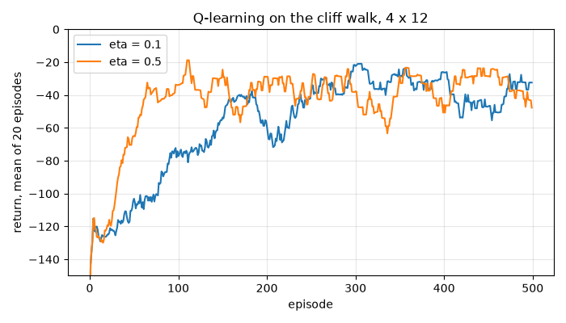

\page bitrl_example_log_experiment Logging an experiment

An experiment is worth something only if it can be read back and compared later: what it ran with, what happened
in every episode, and what came of it. This example runs an experiment, Q-learning on the cliff walk with two
learning rates, and logs it in a directory of its own. It trains on the cliff walk of \ref bitrl_example_export_policy,
written in C++, so it needs no environment server, unless it also logs to Tensorboard.

## What it logs

Every run of the example makes a directory named after the experiment and the time it started:

@code{.sh}
experiments/q_learning_cliff_walk_20261120_190821/
    config.json              the settings, written before training
    eta_0p1/episodes.csv     the return and the iterations of every episode, with a learning rate of 0.1
    eta_0p1/policy.csv       the greedy policy the run ended with
    eta_0p5/...              the same, with a learning rate of 0.5
    summary.json             the result of every run, written at the end
@endcode

- **The settings** go in `config.json` first, so that even a run that fails says what it ran with. They are written
  with nlohmann/json, which comes with bitsim.
- **Every episode** is a row of `episodes.csv`, written with bitsim's `CSVWriter` as the run goes: the episode, its
  return and the number of iterations the solver reports for it.
- **The policy** a run ends with is saved with `MaxTabularPolicy::save`, so it can be loaded and played later, see
  \ref bitrl_example_export_policy.
- **The results**, the best return and the mean return of the last 100 episodes of every run, and the wall time,
  go in `summary.json` when the experiment ends.

The run directories are `eta_0p1`, not `eta_0.1`: bitsim's file writers take a dot anywhere in a path for the start
of the file's suffix.

## Tensorboard

With `--tensorboard URL` the example also sends the return and the iterations of every episode to
<a href="https://www.tensorflow.org/tensorboard">Tensorboard</a>, through
\ref bitrl::network::TensorboardServer "TensorboardServer" and the
<a href="https://github.com/pockerman/bitrl-rest-api">bitrl-rest-api</a> server, which runs the Python side:

@code{.sh}
./log_experiment --tensorboard http://0.0.0.0:8001
tensorboard --logdir experiments
@endcode

Every run calls `init` with its own `tensorboard/` directory and `close` at its end, so Tensorboard shows the runs
side by side as they train.

## Reading it back

`plot.py` reads an experiment directory and plots the return of every run, averaged over 20 episodes:

@code{.sh}
python plot.py experiments/q_learning_cliff_walk_20261120_190821
@endcode

|  |
|:--:|
| **The return of every episode of the two runs, averaged over 20 episodes.** |

With a learning rate of 0.5 Q-learning reaches a return of about -30 within 100 episodes; with 0.1 it takes about
300. Neither settles at the -13 of the shortest path: Q-learning learns the path along the edge of the cliff, and
the agent, which still explores with \f$\epsilon = 0.1\f$, falls off it now and then. The example printed

@code{.sh}
eta_0p1: mean return of the last 100 episodes -42.38, best -13
eta_0p5: mean return of the last 100 episodes -32.43, best -13
@endcode

## The driver code

\include log_experiment/log_experiment.cpp
