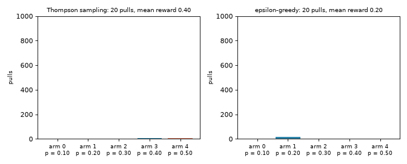

\page bitrl_example_multi_armed_bandits Multi-armed bandits

In this example we will look at how to solve the <a href="https://en.wikipedia.org/wiki/Multi-armed_bandit">multi-armed bandits problem</a>.
In particular, we will look at how to use two specific algorithms namely 
\f$\epsilon\f$-greedy and <a href="https://en.wikipedia.org/wiki/Thompson_sampling">Thompson sampling</a>.

The multi-armed bandits framework has a lot of applications to online decision-making such as 
advertisement placement, and recommendation engines. 
An algorithm that solves the problem essentially provides a policy that optimizes
for a given criteria e.g. reward accumulated over how to choose amongst the available options.

----
**Remark**

The article, by  James LeDoux, <a href="https://jamesrledoux.com/algorithms/bandit-algorithms-epsilon-ucb-exp-python/">
Multi-Armed Bandits in Python: Epsilon Greedy, UCB1, Bayesian UCB, and EXP3</a>
provides a nice overview of \f$\epsilon\f$-greedy and Thompson sampling whilst the book 
<a href="https://www.oreilly.com/library/view/bandit-algorithms-for/9781449341565/">Bandit Algorithms for Website Optimization</a>
by John Myles White, discusses bandit algorithms for website optimization</a>.

----

\f$\epsilon\f$-greedy sampling

Perhaps one of the simplest approaches to solve the bandits problem is an 
\f$\epsilon\f$-greedy sampling strategy. As probably the name suggests, the algorithm
most of the time will greedily select the action with the highest accumulated reward.
However for a small probability, \f$\epsilon\f$, the algorithm will randomly select an action
amonst the available ones. This is a very simple algorithm and often provides quite good results.

The \f$\epsilon\f$-greedy sampling is implemented in the class  \ref bitrl::rl::policies::EpsilonGreedyPolicy "bitrl::rl::policies::EpsilonGreedyPolicy".

### Thompson sampling

According to wikipedia, Thompson sampling is an approach for selecting actions that 
simultaneously address the <a href="https://en.wikipedia.org/wiki/Exploration%E2%80%93exploitation_dilemma">exploration–exploitation dilemma</a>
in the multi-armed bandit problem. When using Thompson sampling we choose the action that maximizes the expected reward with respect to a randomly drawn belief. 

In the implementation below, we will use the <a href="https://en.wikipedia.org/wiki/Beta_distribution">Beta distribution</a>
but this need not be the case. Feel free to experiment with this.

The class \ref bitrl::envs::bandits::MultiArmedBandits "bitrl::envs::bandits::MultiArmedBandits" conveniently wraps the multi-armed bandits
framework into an environment we can utilise.

## The results

The example compares the two on five arms that pay 1 with probabilities 0.1, 0.2, 0.3, 0.4 and 0.5, for 1000
pulls each, and writes every pull to `pulls.csv`.

|  |
|:--:|
| **How often each method pulled every arm, every 20 pulls. The best arm is orange.** |

Both find the best arm. Thompson sampling pulled it 785 times and spent most of the rest on arm 3, the second
best, for a mean reward of 0.455; \f$\epsilon\f$-greedy pulled it 752 times and spread the rest over all the arms,
as its random pulls do, for a mean of 0.432. The best possible is 0.5. `examples/tools/bandit_gif.py` draws
`pulls.csv`:

@code{.sh}
python examples/tools/bandit_gif.py pulls.csv --every 20 --out multi_armed_bandits.gif
@endcode

## Driver code

\include multi_armed_bandits/multi_armed_bandits.cpp

Running the driver above produces the following output (this may be different on your machine.

@code
Running thompson sampling
Thompson reward: 484
Thompson selected levers: 306 158 256 250  30
Running epsilon greedy sampling
epsilon-greedy reward: 486
epsilon-greedy selected levers: 840  49  36  34  41
========================================
Running thompson sampling
Thompson reward: 447
Thompson selected levers:  19   9  41 229 702
Running epsilon greedy sampling
epsilon-greedy reward: 140
epsilon-greedy selected levers: 840  36  45  37  42
@endcode

We can see that when all levers have the same probability of success Thompson sampling and
\f$\epsilon\f$-greedy perform more or less the same, with \f$\epsilon\f$-greedy having some better performance.
Notice also that Thompson sampling somehow spreads the decision-making amongst the equally good levers.
However, when the levers have different probability of success, Thompson sampling outperforms
\f$\epsilon\f$-greedy by roughly a factor of 4.  Also notice that Thompson sampling favours the last lever
as one would expect. In contrast, \f$\epsilon\f$-greedy seems to favour the lever with the lowest
success probability.

Although we did not implement this here, we can decay \f$\epsilon\f$ over time. This makes sense since as the 
agent spends more time in the game it aquires more knowledge and therefore it does not need to explore as often as
it needs in the early stages. Alternatively, we can have the agent acting completely at random at the beginning
and the then fully exploit.
