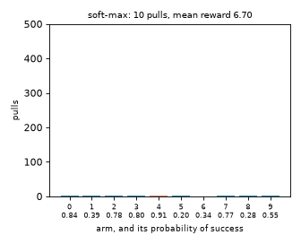

\page bitrl_example_softmax_bandits Multi-armed bandits with a soft-max policy

\ref bitrl_example_multi_armed_bandits solved a multi-armed bandit with \f$\epsilon\f$-greedy and Thompson sampling. This
example solves a 10-armed bandit with a soft-max policy instead. It follows the example in
<a href="https://www.manning.com/books/deep-reinforcement-learning-in-action">Deep Reinforcement Learning in Action</a>.

## The bandit

Each of the 10 arms has a probability \f$p_i\f$, drawn uniformly from \f$[0, 1]\f$ at the start. Pulling arm
\f$i\f$ gives a reward of 1 plus one for each of 10 trials that succeeds with probability \f$p_i\f$, so its
expected reward is \f$1 + 10 p_i\f$. The agent does not know the \f$p_i\f$. It keeps, for every arm, how often
it pulled it and the mean reward it got from it.

## The soft-max policy

Always pulling the arm with the best mean so far never tries the others, and an arm that was unlucky at first is
never tried again. A soft-max policy picks every arm with a probability that grows with its mean reward
\f$Q_i\f$,

\f[
P(i) = \frac{e^{Q_i / \tau}}{\sum_{j} e^{Q_j / \tau}} ,
\f]

where the temperature \f$\tau\f$, 0.7 here, sets how strongly it favours the best arms. A large \f$\tau\f$ picks
the arms almost uniformly; a small one almost always picks the best. `bitrl::maths::softmax_vec` computes the
probabilities, and a `std::discrete_distribution` picks an arm from them.

Every arm's mean starts at 11, the largest reward an arm can pay. Started at 0, the first arm that paid anything
would have a mean so far above the untried arms that the policy would pull it for ever. Started at the largest
reward, every untried arm looks as good as any can be until it is tried, so each is tried early.

## What it writes

The example runs 500 pulls. After each one it prints the mean reward of all the pulls so far, and at the end it
writes these means to `rewards.csv`, one per line, in the directory it runs from. It also writes `pulls.csv`:
the success probability of every arm, then the arm and the reward of every pull.

## The results

|  |
|:--:|
| **How often the soft-max policy pulled every arm, every 10 pulls. The best arm is orange.** |

The best arm, 4, succeeds with probability 0.91, but arms 0, 3 and 7 are close behind at 0.84, 0.80 and 0.77, so
the policy keeps pulling them too: in 500 pulls arm 4 got 237, arm 3 127, arm 0 79 and arm 7 48, and the other six
one to four each. Among them is arm 2, at 0.78 as good as arm 7: a poor first reward lowered its mean below the
others', and the soft-max rarely tried it again. Lowering \f$\tau\f$ makes such arms rarer still; raising it
spreads the pulls over the poor arms as well. The mean reward of the 500 pulls was 9.58, against the best arm's 10.1.
`examples/tools/bandit_gif.py` draws `pulls.csv`:

@code{.sh}
python examples/tools/bandit_gif.py pulls.csv --every 10 --out softmax_bandits.gif
@endcode

## The driver code

\include softmax_bandits/softmax_bandits.cpp
