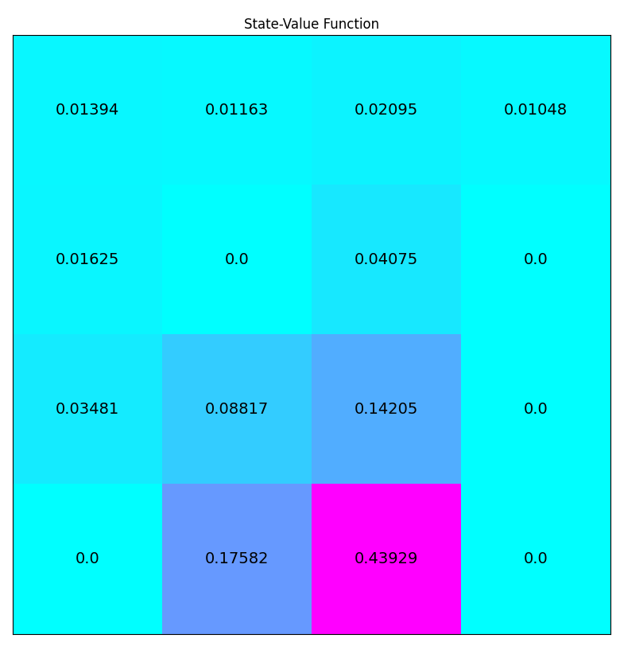

\page bitrl_example_iterative_policy_evaluation Iterative policy evaluation on FrozenLake

Before an agent can improve a policy, it has to know how good the policy is. This example computes the value
function of a policy on the 4x4 _FrozenLake_ from
<a href="https://gymnasium.farama.org/environments/toy_text/frozen_lake/">Gymnasium</a>. It is the first half
of policy iteration, which \ref bitrl_example_policy_iteration completes, and value iteration in \ref bitrl_example_value_iteration builds
on the same update.

The environment runs on the <a href="https://github.com/pockerman/bitrl-rest-api">bitrl-rest-api</a> server,
which the example talks to over HTTP at `http://0.0.0.0:8001/api`, so start the server first. The example makes
the environment with its default options, so the lake is slippery: an action moves the agent in the intended
direction only some of the time.

## Iterative policy evaluation

The value \f$V_{\pi}(s)\f$ of a state is the return the agent expects from it when it follows the policy
\f$\pi\f$. It satisfies the Bellman expectation equation

\f[
V_{\pi}(s) = \sum_{\alpha} \pi(\alpha | s) \sum_{s', r} p(s', r | s, \alpha) \left[ r + \gamma V_{\pi}(s') \right] .
\f]

Iterative policy evaluation starts from \f$V = 0\f$ and sweeps over the states, replacing \f$V(s)\f$ with the
right hand side, until a sweep changes no value by more than a tolerance. It needs the transition probabilities
and rewards \f$p(s', r | s, \alpha)\f$, which \ref bitrl::envs::gymnasium::FrozenLake "FrozenLake" provides.

The policy is a \ref bitrl::rl::policies::UniformDiscretePolicy "UniformDiscretePolicy", which picks each of the
four actions with probability 1/4. \ref bitrl::rl::algos::dp::IterativePolicyEvalutationSolver "IterativePolicyEvalutationSolver"
uses \f$\gamma = 1\f$ and a tolerance of \f$10^{-8}\f$, and \ref bitrl::rl::RLSerialAgentTrainer "RLSerialAgentTrainer"
runs one sweep per training episode, at most 10000 of them.

## The results

The example writes the value of each state to `iterative_policy_evaluation_frozen_lake.csv` in the directory
it runs from. `plot.py` draws it on the grid of the lake:

@code{.sh}
python plot.py iterative_policy_evaluation_frozen_lake.csv
@endcode

|  |
|:--:|
| **Figure 1: The value of each state under the uniform random policy.** |

The holes and the goal have a value of 0, because the episode ends there. The only reward is 1, for reaching the
goal, so with \f$\gamma = 1\f$ the value of a state is the probability that the random policy gets from it to the
goal before it falls into a hole. From the start, in the top left corner, that is only about 1.4%. The state
to the left of the goal has the largest value, 0.44.

## The driver code

\include iterative_policy_evaluation/iterative_policy_evaluation.cpp
