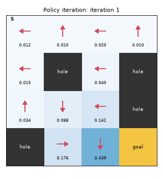

\page bitrl_example_policy_iteration Policy iteration on FrozenLake

This example solves the 4x4 _FrozenLake_ environment from
<a href="https://gymnasium.farama.org/environments/toy_text/frozen_lake/">Gymnasium</a> with policy
iteration. The environment runs on the <a href="https://github.com/pockerman/bitrl-rest-api">bitrl-rest-api</a>
server, which the example talks to over HTTP at `http://0.0.0.0:8001/api`, so start the server first.

Policy iteration is a dynamic programming method: it needs a model of the environment, the transition
probabilities and rewards, which \ref bitrl::envs::gymnasium::FrozenLake "FrozenLake" provides. Starting
from a policy, it repeats two steps until the policy stops changing:

- **Policy evaluation.** Compute the state value function \f$V_{\pi}\f$ of the current policy \f$\pi\f$ by
  sweeping over the states with the Bellman expectation equation
  \f$V_{\pi}(s) = \sum_{\alpha} \pi(\alpha | s) \sum_{s', r} p(s', r | s, \alpha) \left[ r + \gamma V_{\pi}(s') \right]\f$.
- **Policy improvement.** Make the policy greedy with respect to \f$V_{\pi}\f$: in each state, pick the action
  with the largest expected return.

The example starts from a \ref bitrl::rl::policies::UniformDiscretePolicy "UniformDiscretePolicy", which picks
every action with the same probability. \ref bitrl::rl::algos::dp::PolicyIterationSolver "PolicyIterationSolver"
uses \f$\gamma = 1\f$ and runs 15 sweeps of policy evaluation, with a tolerance of \f$10^{-8}\f$, in every
iteration. The example runs the iterations itself, at most 100 of them, rather than with
\ref bitrl::rl::RLSerialAgentTrainer "RLSerialAgentTrainer", so that it can write the value function after every
iteration to `sweeps.csv`, and stops once policy improvement leaves the policy unchanged, after 4 iterations. The environment is made with its default options,
so the lake is slippery: an action moves the agent in the intended direction only some of the time. The state
value function is then saved to `policy_iteration_frozen_lake_v0.csv`.

`plot.py` draws the state value function on the 4x4 grid. It reads `policy_iteration.csv`, so rename the file
the example writes or pass its name to `main`.

## The results

|  |
|:--:|
| **The value function and the greedy policy after every iteration.** |

The greedy actions after the last iteration are optimal in every state: they are the actions of the largest value
under the optimal value function, which value iteration on the same slippery lake gives. The values are not the
optimal ones, 0.63 at the start where the optimal value is 0.82, because 15 sweeps of evaluation per iteration do
not evaluate a policy fully; they are enough to rank the actions. The GIF is made with

@code{.sh}
python examples/tools/value_gif.py sweeps.csv --slippery --step iteration --out policy_iteration.gif
@endcode

## The driver code

\include policy_iteration/policy_iteration.cpp
