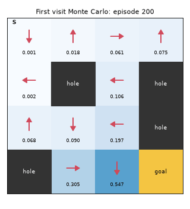

\page bitrl_example_first_visit_monte_carlo First visit Monte Carlo on FrozenLake

\ref bitrl_example_iterative_policy_evaluation computed the value function of a policy on _FrozenLake_ with iterative policy evaluation,
which needs the transition probabilities of the environment. Monte Carlo methods need no model. They estimate
the value of a state from the returns that follow it in episodes the agent plays. This example estimates the
value function of a random policy on the 4x4 _FrozenLake_ from
<a href="https://gymnasium.farama.org/environments/toy_text/frozen_lake/">Gymnasium</a> with first visit Monte
Carlo.

The environment runs on the <a href="https://github.com/pockerman/bitrl-rest-api">bitrl-rest-api</a> server,
which the example talks to over HTTP at `http://0.0.0.0:8001/api`, so start the server first. It is made with
its default options, so the lake is slippery.

## First visit Monte Carlo

In every training episode the solver plays an episode, a trajectory of at most `max_steps` = 200 steps, and
walks through it. The first time it meets a state \f$s\f$ in the trajectory, it computes the return \f$G\f$ from
that step to the end of the trajectory and moves the value of the state towards it,

\f[
V(s) \leftarrow V(s) + \alpha \left[ G - V(s) \right] .
\f]

Later visits to the same state in the same trajectory are skipped; that is what makes it _first_ visit. Every
visit Monte Carlo would update the value at each of them.

\ref bitrl::rl::algos::mc::FirstVisitMCSolver "FirstVisitMCSolver" takes three types from the example:

- `TrajectoryGenerator` plays a trajectory with `bitrl::envs::create_trajectory`, picking every action with
  `RandomActionSelector`, which draws one of the four actions uniformly.
- `InverseDecayLRScheduler` decays the learning rate from the solver's initial value, 0.5, as
  \f$\alpha_k = 0.5 / (1 + k / 100)\f$ in episode \f$k\f$, but not below 0.001.
- `DiscountGenerator` gives the discount of each step of the trajectory. It returns \f$1^k = 1\f$ for every
  step, so the rewards are not discounted.

The example runs 10000 training episodes itself, as \ref bitrl::rl::RLSerialAgentTrainer "RLSerialAgentTrainer"
would, so that it can write the value function every 200 episodes to `sweeps.csv`.

## What it writes

At the end the example writes the value of each state to `first_visit_mc_frozen_lake.csv` in the directory it
runs from. It estimates the same quantity as \ref bitrl_example_iterative_policy_evaluation, the value function of the uniform random
policy, so the two can be compared. With a constant \f$\alpha = 0.5\f$ the estimates would follow the latest
returns and stay noisy; with the decaying rate they average more of them and settle.

|  |
|:--:|
| **The value estimates every 200 episodes, with the greedy actions of the estimates.** |

After 10000 episodes the start has an estimate of 0.019 and the cell left of the goal 0.42, against the true
values of 0.014 and 0.44 that \ref bitrl_example_iterative_policy_evaluation computes: estimates from sampled
returns, close but not exact. The GIF is made with

@code{.sh}
python examples/tools/value_gif.py sweeps.csv --slippery --step episode --out first_visit_monte_carlo.gif
@endcode

## The driver code

\include first_visit_monte_carlo/first_visit_monte_carlo.cpp
