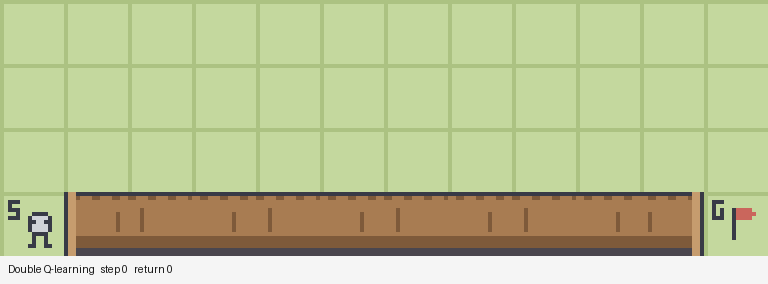
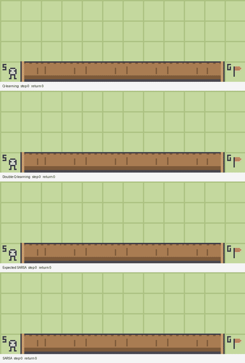

\page bitrl_example_double_q_learning Double Q-learning on CliffWalking

This example trains an agent on <a href="https://gymnasium.farama.org/environments/toy_text/cliff_walking/">CliffWalking</a>
with double Q-learning. It has the settings of \ref bitrl_example_sarsa, \ref bitrl_example_q_learning and
\ref bitrl_example_expected_sarsa, so the four can be compared. The environment is
\ref bitrl::envs::gymnasium::CliffWorld "CliffWorld" and runs on the
<a href="https://github.com/pockerman/bitrl-rest-api">bitrl-rest-api</a> server, which the example talks to at
`http://0.0.0.0:8001/api`, so start the server first.

## Double Q-learning

Q-learning moves \f$Q(s, \alpha)\f$ towards \f$r + \gamma \max_{\alpha'} Q(s', \alpha')\f$. The values in the table
are estimates with errors, and the largest of several estimates is more likely to be one that is too high than one
that is too low, so Q-learning overestimates. Double Q-learning keeps two tables. Every step a coin picks one of them,
say \f$Q_1\f$, to update; the action that is best in \f$Q_1\f$ at the next state is valued with the other table:

\f[
Q_1(s, \alpha) \leftarrow Q_1(s, \alpha) + \eta \left[ r + \gamma Q_2\left(s', \arg\max_{\alpha'} Q_1(s', \alpha')\right) - Q_1(s, \alpha) \right] .
\f]

The errors of the two tables are independent, so the value of the chosen action is no longer biased upwards. The
agent acts \f$\epsilon\f$-greedily on the sum of the two tables, with
\ref bitrl::rl::policies::EpsilonDoubleQTableGreedyPolicy "EpsilonDoubleQTableGreedyPolicy". After the step that ends
an episode the target is the reward alone.

\ref bitrl::rl::algos::td::DoubleQLearning "DoubleQLearning" uses \f$\gamma = 1\f$, \f$\eta = 0.5\f$ and a constant
\f$\epsilon = 0.1\f$, and \ref bitrl::rl::RLSerialAgentTrainer "RLSerialAgentTrainer" runs 2000 episodes of at most
100 steps, as for the other three.

## What it writes

| File | What |
| ---- | ---- |
| `double_q_learning_cliff_walking_v1.csv` | both tables: a row per state and table, a column per action |
| `reward_per_itr.csv` | the reward of every training episode |
| `policy.csv` | the greedy policy of the sum of the two tables |

## The learned policy

|  |
|:--:|
| **The greedy policy double Q-learning learned, played in Gymnasium: return -17.** |

Q-learning learns the shortest path, along the edge of the cliff, in 13 steps. Double Q-learning, with the same
settings and the same number of episodes, kept two rows away from the cliff, as SARSA does, and takes 17 steps. A
likely reason is that each of its tables is updated with only half of the steps, so after the same 2000 episodes the
values of the cells along the edge, where the exploring agent falls off the cliff, have been pulled down by those
falls more than they have been corrected by the greedy path along them; with more episodes it would be expected to
move towards Q-learning's path.

|  |
|:--:|
| **From the top: Q-learning (-13), double Q-learning (-17), expected SARSA (-15) and SARSA (-17).** |

## The driver code

\include double_q_learning/double_q_learning.cpp
