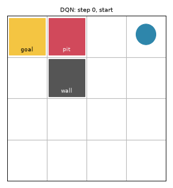

\page bitrl_example_dqn DQN on Gridworld

This example trains a deep Q-network, DQN, to walk an agent to the goal of a 4 x 4 grid. The environment is
\ref bitrl::envs::grid_world::Gridworld "Gridworld", from the book
<a href="https://www.manning.com/books/deep-reinforcement-learning-in-action">Deep Reinforcement Learning in Action</a>,
and runs in the library itself, so it needs no server. The board has the player, a goal, a pit and a wall. Every
step pays -1, the goal 10 and the pit -10, and either ends the episode. The board is static here: every episode
starts with the pieces in the same cells. \ref bitrl_example_dqn_experience_replay trains on random boards.

## DQN

The network takes the board, a one-hot 4 x 4 plane for each of the four pieces, 64 values with a little noise
added, and gives a Q value for each of the four moves through two hidden layers of 150 and 100 units with ReLU.
The output layer has no ReLU: the Q values are mostly negative, since every step pays -1. Every step moves the Q
value of the action taken towards \f$r + \gamma \max_{\alpha'} Q(s', \alpha')\f$, with \f$\gamma = 0.9\f$, or
towards \f$r\f$ alone on the step that ends the episode, by one step of Adam on the squared error. The agent acts
\f$\epsilon\f$-greedily, with \f$\epsilon\f$ going from 1 down to 0.1 over the 1000 training episodes.

## The learned policy

|  |
|:--:|
| **The greedy policy DQN learned: 7 steps to the goal, a return of 4.** |

The mean length of the training episodes, 100 at a time, went 34, 29, 22, 19, 16, 13, 11, 10, 8, 7.6, as
\f$\epsilon\f$ fell and the agent learned the way. After training the example plays the greedy policy once and
writes every board to `episode.csv`. It takes the shortest way around the wall and the pit, 7 steps.
`examples/tools/grid_world_gif.py` draws the file:

@code{.sh}
python examples/tools/grid_world_gif.py episode.csv --title DQN --out dqn.gif
@endcode

The example also writes the mean loss and the mean reward of every training episode to
`experiments/3/dqn_grid_world_policy_losses.csv` and `experiments/3/dqn_grid_world_policy_rewards.csv`.

## The driver code

\include dqn/dqn.cpp
