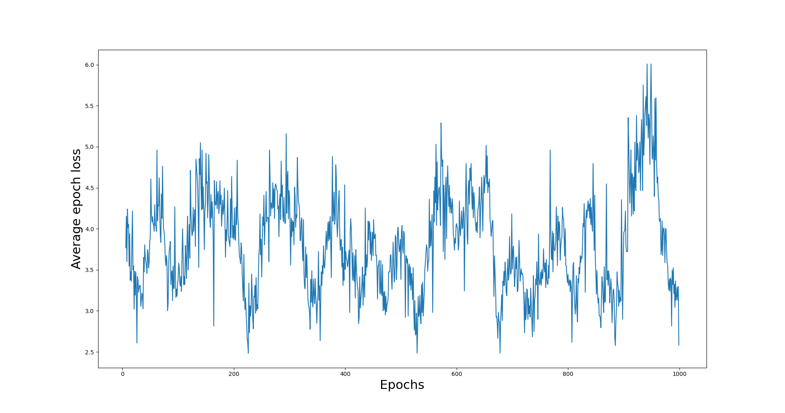

\page bitrl_example_dqn_experience_replay DQN algorithm on Gridworld with experience replay

Example <a href="#">Example 12: DQN algorithm on Gridworld</a> trained a DQN-based agent to navigate in the
```Gridworld``` environment. We assumed that the environment was static which made it very easy for the agent to learn how
to act on a given state. In this example, we will assume that the environment is random and we will use an experience buffer
to train again a DQN agent.

We will code the same model as is done in the <a href="https://www.manning.com/books/deep-reinforcement-learning-in-action">Deep Reinforcement Learning in Action</a> 
book so you may also want to follow the code therein.

## Driver code

\include dqn_experience_replay/dqn_experience_replay.cpp

The average per epoch loss is shown in the figure below

|  |
|:--:|
| **Figure: Average loss per epoch.**|

