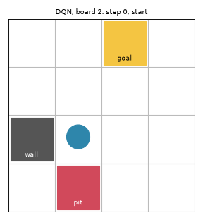

\page bitrl_example_dqn_experience_replay DQN with experience replay on Gridworld

\ref bitrl_example_dqn trained a DQN on a static board, where every episode starts the same. Here every episode
starts on a random board of \ref bitrl::envs::grid_world::Gridworld "Gridworld", with the player, the goal, the
pit and the wall in four random cells, so the network has to learn to read the board rather than one path. The
model is the one of <a href="https://www.manning.com/books/deep-reinforcement-learning-in-action">Deep Reinforcement Learning in Action</a>.

## Experience replay

Updating the network with each step as it comes, as \ref bitrl_example_dqn does, trains it on steps that follow
each other and are alike; with random boards that makes it chase the latest board. Here the steps go into a
buffer of the latest 1000 and, once it holds 200, every step trains the network on a batch of 200 steps drawn
from it at random. The batch mixes many boards, and every step is used in many updates. The network, the targets
and \f$\gamma = 0.9\f$ are those of \ref bitrl_example_dqn; \f$\epsilon\f$ stays at 0.3, episodes stop after 50
steps, and the example trains for 5000 episodes, which take about a minute.

## The learned policy

|  |
|:--:|
| **The greedy policy on six of the boards it was tested on: five it solves and the last one it does not.** |

The mean length of the training episodes, 1000 at a time, went 13.3, 8.0, 5.9, 5.5, 5.7. After training the
example plays the greedy policy on 100 new random boards, at most 20 steps each, and writes every board to
`episode.csv`. It reached the goal on 85 of them, in 2.9 steps on average, and never fell into the pit; on the
other 15 it got stuck, as on the last board of the GIF, where it keeps walking into the edge of the grid. More
training episodes, or an \f$\epsilon\f$ that decays, would help. The GIF shows boards 1, 2, 3, 6, 7 and 0:

@code{.sh}
python examples/tools/grid_world_gif.py episode.csv --title DQN --episodes 1,2,3,6,7,0 --out dqn_experience_replay.gif
@endcode

## The driver code

\include dqn_experience_replay/dqn_experience_replay.cpp
