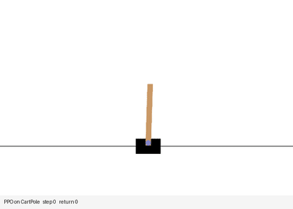

\page bitrl_example_ppo_cartpole PPO on CartPole

This example trains an agent to balance the pole of <a href="https://gymnasium.farama.org/environments/classic_control/cart_pole/">CartPole</a>
with proximal policy optimization (PPO). CartPole has two actions, push the cart left and push it right, and an
episode ends when the pole falls over or the cart leaves the track, or after 500 steps. The environment runs on the
<a href="https://github.com/pockerman/bitrl-rest-api">bitrl-rest-api</a> server, which the example talks to at
`http://0.0.0.0:8001/api`, so start the server first.

|  |
|:--:|
| **The policy PPO learned, playing greedily: it keeps the pole up for 339 of the 500 steps.** |

## PPO

PPO is an actor-critic method. The **actor** is the policy, \f$\pi_\theta(\alpha | s)\f$, and the **critic**
estimates the value of a state, \f$V(s)\f$. After an episode, the advantage of every step is how much better its
discounted return \f$G_t\f$ was than the critic expected, \f$A_t = G_t - V(s_t)\f$. A policy gradient step raises the
probability of the actions with a positive advantage; PPO limits how far one step can go. With the ratio
\f$\rho_t = \pi_\theta(\alpha_t | s_t) / \pi_{\theta_{old}}(\alpha_t | s_t)\f$ of the new and the old probability of
an action, it maximises

\f[
\min\left( \rho_t A_t, \; \mathrm{clip}(\rho_t, 1 - \epsilon, 1 + \epsilon) A_t \right) ,
\f]

so moving \f$\rho_t\f$ further than \f$\epsilon\f$ from 1 gains nothing. Because of that, it can make several passes
over the same episode without the policy running away from the one that collected it.

\ref bitrl::rl::algos::pg::PPOSolver "PPOSolver" collects an episode of at most 500 steps, normalises the
advantages, and makes 4 passes over it, each minimising the clipped actor loss plus half the squared error of the
critic minus 0.01 times the entropy of the policy. The example uses \f$\gamma = 0.99\f$, \f$\epsilon = 0.2\f$, and
Adam with a learning rate of 0.001 for both networks, built with bitrl's optimizer factory, for 500 episodes.

## The networks

PPOSolver takes the actor and the critic as types, and calls

- `actor->act(state)`, which samples an action and returns it with its log probability;
- `actor->evaluate(states, actions)`, which returns the log probabilities of a batch of actions, the entropy of the
  policy and the network's output;
- `critic->evaluate(state)` and `critic->forward(states)`, the value of a state and of a batch.

Here the actor has two hidden layers of 64 units and gives the logits of the two actions, and
\ref bitrl::maths::stats::TorchCategorical "TorchCategorical" is the distribution over them, as in
\ref bitrl_example_pytorch_policy_network. The critic has the same hidden layers and one output.

## The results

The mean return of the training episodes, a hundred at a time:

| Episodes | Mean return |
| -------- | ----------- |
| 1-100 | 273 |
| 101-200 | 283 |
| 201-300 | 357 |
| 301-400 | 434 |
| 401-500 | 450 |

Every episode starts from the next seed, so from a different state. The training took 119 s, most of it in the
HTTP requests to the server, one per step. After training the example plays an episode with the greedy policy, the
action with the larger logit, from the next seed, and writes the seed and its actions to `episode.csv`; the policy
kept the pole up for 339 of the 500 steps. The returns were still rising when training stopped: more episodes
would help. `examples/tools/episode_gif.py` replays them in Gymnasium to make the
GIF above:

@code{.sh}
python examples/tools/episode_gif.py --env CartPole-v1 --actions episode.csv --fps 50 --out ppo_cartpole.gif
@endcode

## The driver code

\include ppo_cartpole/ppo_cartpole.cpp
