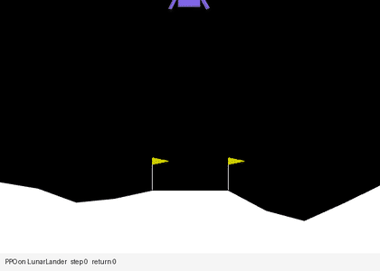

\page bitrl_example_ppo_lunar_lander PPO on LunarLander

This example trains an agent to land the lander of _LunarLander_ from
<a href="https://gymnasium.farama.org/environments/box2d/lunar_lander/">Gymnasium</a> with proximal policy
optimization (PPO). It uses the continuous version of the environment, `LunarLanderContinuous` in its `v3`
form: the agent sets the throttle of the main engine and of the side engines, two numbers between -1 and 1,
instead of picking one of four discrete actions. The observation has 8 numbers: the position, velocity, angle
and angular velocity of the lander, and whether each of its legs touches the ground.

The environment runs on the <a href="https://github.com/pockerman/bitrl-rest-api">bitrl-rest-api</a> server,
which the example talks to over HTTP at `http://0.0.0.0:8001/api`, so start the server first.

## PPO

PPO is an actor-critic method, like A2C in \ref bitrl_example_a2c. The actor is the policy, and the critic
estimates the value of a state, which gives the advantage of an action: how much better its return was than the
critic expected. A plain policy gradient step can change the policy so much that it gets worse and does not
recover. PPO limits the step. With the ratio \f$\rho = \pi_{\theta}(\alpha | s) / \pi_{\theta_{old}}(\alpha | s)\f$
of the new and the old probability of an action and its advantage \f$A\f$, it maximises

\f[
\min\left( \rho A, \; \mathrm{clip}(\rho, 1 - \epsilon, 1 + \epsilon) A \right) ,
\f]

so moving \f$\rho\f$ further than \f$\epsilon\f$ from 1 brings no more gain. Because of that it can make several
passes over the same batch of experience.

## The networks

The actor, `ActorNet`, has two hidden layers of 128 and 64 units with \f$\tanh\f$, and gives the mean of a normal
distribution for each of the two actions. The log of its standard deviation is a learned parameter of its own,
the same in every state, that starts at -0.5, a standard deviation of 0.6, and stays between -5 and 0.5. The actor
samples an action from that distribution and squashes it into \f$[-1, 1]\f$ with \f$\tanh\f$; the log probability
of the action is corrected for the squashing. A standard deviation that the network can raise in every state, as
an earlier version of this example had, grows until \f$\tanh\f$ squashes almost every action to -1 or 1, and the
lander only learns to fire its engines at full throttle. The critic, `CriticNet`, has hidden layers of 128 and 256
units and one output, the value of the state.

\ref bitrl::rl::algos::pg::PPOSolver "PPOSolver" trains both with Adam and a learning rate of \f$3 \cdot 10^{-4}\f$,
on the CPU, with \f$\gamma = 0.99\f$, a clip \f$\epsilon\f$ of 0.2, 4 passes over each episode and normalised
advantages. The example trains for 2000 episodes of at most 1000 steps, the limit of Gymnasium's LunarLander;
every episode starts from the next seed, so from a different terrain and push.

## The learned policy

|  |
|:--:|
| **One of the greedy landings: on its legs at the edge of the pad, a return of 190.** |

The mean return of the training episodes, 200 at a time, went -232, -62, 1, 82, 119, 128, 85, 131, 138, 136. The
training took about 22 minutes, almost all of it in the HTTP requests to the server. After training the example
lands 10 times with the greedy policy, \f$\tanh\f$ of the mean, each from the next seed, prints the returns, and
writes the actions of every landing to `episode_<k>.csv`, at full precision: a landing is chaotic, and a replay
from rounded actions drifts away from it.

| Landing | 0 | 1 | 2 | 3 | 4 | 5 | 6 | 7 | 8 | 9 |
| ------- | - | - | - | - | - | - | - | - | - | - |
| Return | 190 | 162 | 156 | 191 | 233 | 176 | 218 | -45 | 185 | 147 |

Nine of the ten land, and one crashes; the mean return is 161. LunarLander counts as solved at a mean of 200, so
the policy lands but not yet precisely, often away from the middle of the pad: more episodes, or updates from
batches of several episodes rather than one, would be expected to get it there. The GIF is landing 0:

@code{.sh}
python examples/tools/episode_gif.py --env LunarLanderContinuous-v3 --actions episode_0.csv --max-steps 1000 --fps 50 --out ppo_lunar_lander.gif
@endcode

## What it writes

After training, the example writes what the solver recorded to four files in `experiments/1/`, in the directory
it runs from. Each has an index and a value per row:

| File | What |
| ---- | ---- |
| `policy_loss.csv` | the loss of the actor |
| `critic_loss.csv` | the loss of the critic |
| `rewards.csv` | the rewards |
| `episode_duration.csv` | how many steps the episodes lasted |

## The driver code

\include ppo_lunar_lander/ppo_lunar_lander.cpp
