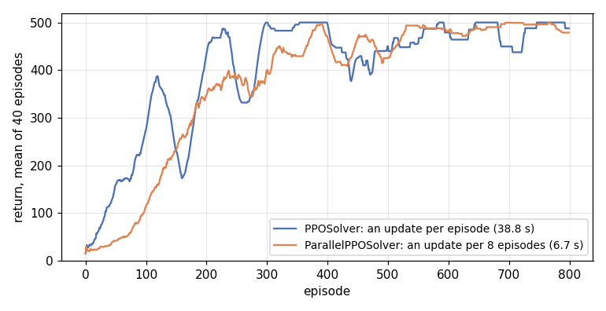

\page bitrl_example_ppo_parallel_rollouts PPO from several episodes at once

\ref bitrl_example_ppo_cartpole learns to balance the pole of CartPole with
\ref bitrl::rl::algos::pg::PPOSolver "PPOSolver", which plays an episode, learns from it, and plays
the next. This example learns from several episodes at once:
\ref bitrl::rl::algos::pg::ParallelPPOSolver "ParallelPPOSolver" plays an episode in each of 8
copies of the environment at the same time, and learns from the 8 together.

## What you need

Nothing beyond bitrl: the example uses
\ref bitrl::envs::classic_control::CartPole "bitrl::envs::classic_control::CartPole", the
cart-pole of Gymnasium simulated in the example's own process with bitsim's cart-pole dynamics,
so it needs no server. Its dynamics integrate with Runge-Kutta rather than Gymnasium's Euler
step, so the numbers are close to Gymnasium's, not the same.

## Several copies of an environment

\ref bitrl::envs::ParallelEnvs "ParallelEnvs" holds copies of an environment, each made with the
same options and its own seed. `step()` takes an action per copy and steps every copy whose
episode is not over, on the threads of bitsim's thread pool:

@code{.cpp}
ParallelEnvs<CartPole> envs(8);
envs.make("v1", {{"max_steps", uint_t(500)}}, {{"seed", uint_t(42)}}); // copy i: task_seed(42, i)
const auto &first = envs.reset();
const auto &next = envs.step(actions);                                  // an action per copy
@endcode

## Learning from all of them

Every training round of ParallelPPOSolver resets the copies and plays an episode in each. At every
step it puts the states of the copies still playing into one batch, and the policy acts for all of
them with one call, `act_batch(states)`. Then the networks learn from all the episodes of the
round with PPO's clipped objective, as PPOSolver does from one: the advantage of a step is its
discounted return, within its own episode, minus the critic's value of the state.

The actions are sampled on the trainer's thread, so a training is the same whatever the number of
threads that step the copies. The example checks that.

## Running the example

@code{.sh}
./ppo_parallel_rollouts                       # 800 episodes, 8 copies
./ppo_parallel_rollouts --episodes 1600 --copies 16
@endcode

## Output

@code
1. The same number of episodes, learned from one or 8 at a time
  800 episodes of CartPole, at most 500 steps each

                                  time     steps   last 10 % greedy return
  PPOSolver                     38.8 s    329703       493.9         500.0
  ParallelPPOSolver              6.7 s    308851       487.3         500.0
    and copies on threads        7.7 s    308851       487.3         500.0
  the copies on threads learned the same: true

2. An environment whose step takes 1000 microseconds
  3 rounds of 8 episodes, 614 steps
  the copies one after the other: 0.65 s; on 9 threads: 0.20 s, a speed-up of 3.15
  the same episodes: true
@endcode

Both learn to keep the pole up for all 500 steps; the greedy return is the mean of 20 episodes
from starts neither trained on. Episode for episode, PPOSolver climbs faster at first: it updates
the networks after every episode, 8 times as often. ParallelPPOSolver's curve is smoother, since
every update averages over 8 episodes, and the training takes a sixth of the time: one call of the
policy on a batch of 8 states costs little more than a call on one, and it makes an eighth of the
updates.

Stepping the copies of CartPole on threads gains nothing: a step of CartPole takes well under a
microsecond, less than handing it to a thread. It pays off when a step takes time, as it does for
a physics engine such as Chrono, or an environment on a server. The second part gives every step
1 ms of computing, and there the 8 copies on 4 cores run 3 times as fast. Use
`envs.use_threads(false)` for cheap environments.

The example sets `torch::set_num_threads(1)`: on networks this small libtorch's own threads cost
more than they gain, and they compete with the thread pool.

## Things to try

1. Train with 4 and with 16 copies on the same number of episodes. Which reaches a return of 400
   in the fewest seconds?
2. Make `max_passes_over_batch` 8 for ParallelPPOSolver. Does it catch up with PPOSolver episode
   for episode?
3. Leave libtorch its threads (remove `torch::set_num_threads(1)`). How long do the trainings take?

## The code

\include ppo_parallel_rollouts.cpp
