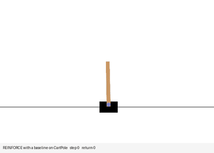
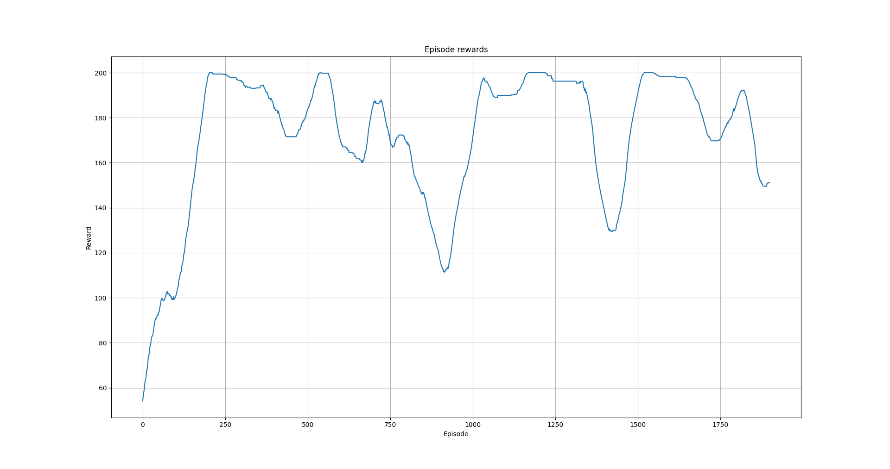
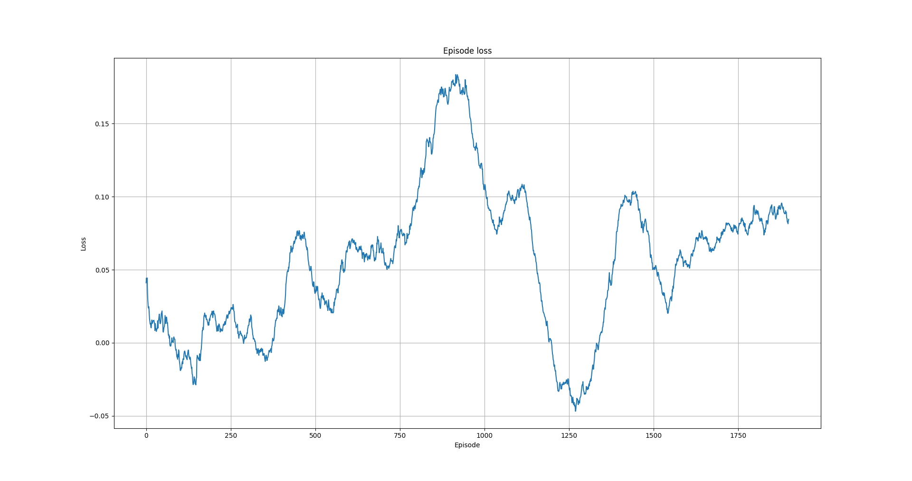
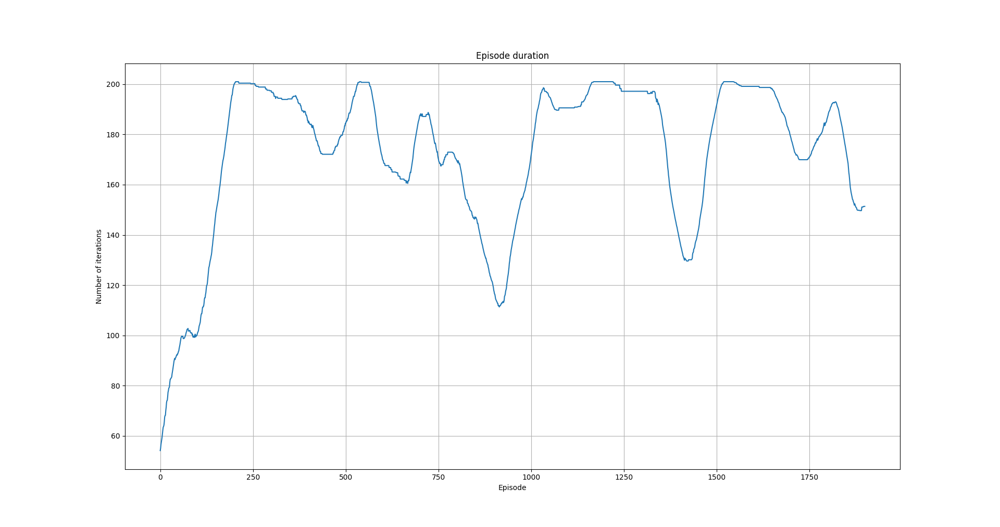

\page bitrl_example_reinforce_baseline REINFORCE with baseline algorithm on CartPole

\ref bitrl_example_reinforce
used the REINFORCE algorithm to build an agent that can control the ```CartPole``` environment.
The REINFORCE algorithm is very sensitive to gradient variance which in turn can affect
training. 

In this example, we will extend the REINFORCE algorithm using a baseline.
This is a generalisation of the REINFORCE algorithm to include a comparison 
of the action value to an arbitrary baseline \f$b(s)\f$ [1]. 
Hence, the gradient of the cost function is now proportional to 

\f[\nabla J(\boldsymbol{\theta}_{t}) \propto \sum_{s} \mu(s) \sum_{\alpha}\left(q_{\pi}(s,\alpha) - b(s)\right )\nabla \pi(\alpha | s,  \boldsymbol{\theta})  \f]

Note that the baseline can be any function, even a random variable, as long as it does not vary with \f$\alpha\f$. 
The update rule in this version of REINFORCE is [1].

\f[\boldsymbol{\theta}_{t+1} = \boldsymbol{\theta}_{t} + \alpha \left(G_t - b(S_t)\right )\frac{\nabla \pi(A_t | S_t, \boldsymbol{\theta}_t)}{\pi(A_t | S_t, \boldsymbol{\theta}_t)}\f]

The baseline function, as mentioned above, can be any function even a unformly zero. 
Thus, the update rule above is a generalization of the REINFORCE algorithm [1]. Although the baseline does not affect the expected value of the update, it can have a, large, effect on its variance [1].
A choice for the baseline is an estimate of the state value i.e. \f$\hat{v}(S_t, \mathbf{w})\f$ where \f$\mathbf{w} \in \mathbb{R}^m\f$ is a weight vector.


We will again use the ```gymnasium.CartPole``` environment.
Specifically, we will use the class \ref bitrl::envs::gymnasium::CartPole "CartPole".
This is a simple class that allows us to
sent HTTP requests to a server that actually runs the environment. We need this as ```gymnasium.CartPole``` is written in Python and we 
want to avoid the complexity of directly executing Python code from the C++ driver.

We will use the policy network we used in \ref bitrl_example_reinforce
The configuation of the REINFORCE solver supports three types of baseline values

- A user specified constant
- Mean value
- Standardization

In this example we will use standardization or whitening as a baseline. In this case the baseline term is given 
by


----
**Remark**

The Medium  article https://medium.com/@fork.tree.ai/understanding-baseline-techniques-for-reinforce-53a1e2279b57
provides a nice overview of baseline techniques.

----

\f[b(S_t) = \frac{G_t - \bar{G}}{\sigma_{G}}\f]

Recall that \f$G_t\f$ is the total, discounted, reward over the episode i.e.

\f[G_t = \sum_{i} \gamma^ir_i\f]

where \f$i\f$ denotes the iteration index within the episode.

Other than that this example is similar to the aforementioned example. Feel free to experiment
with the various baseline types. The dirver code is shown below.

## Driver code

## The learned policy

|  |
|:--:|
| **The greedy policy REINFORCE with a baseline learned: all 500 steps.** |

REINFORCE with a baseline trained for 2000 episodes of at most 200 steps. The mean length of its training
episodes, 250 at a time, went 145, 194, 184, 193, 175, 198, 178, 191, against the cap of 200.

After training the example plays one episode with the greedy policy, the action of the larger probability, from
the next seed, and writes its actions and the seed to `episode.csv`. It kept the pole up for all 500 steps, more
than the 200 steps of the episodes it was trained on. `examples/tools/episode_gif.py` replays the actions in Gymnasium to make the GIF:

@code{.sh}
python examples/tools/episode_gif.py --env CartPole-v1 --actions episode.csv --fps 50 --out reinforce_baseline.gif
@endcode

\include reinforce_baseline/reinforce_baseline.cpp

Running the driver above produces the following plots.


|  |
|:--:|
| **Figure 1: Undiscounted total reward for REINFORCE over training.**|

|  |
|:--:|
| **Figure 2: Loss for REINFORCE over training.**|

|  |
|:--:|
| **Figure 3: Episode duration for REINFORCE over training.**|

## Summary

This example extended \ref bitrl_example_reinforce
by using a baseline term. Specifically, it used standarization or whitening as a baseline.
