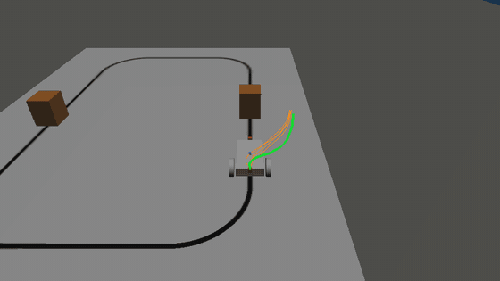
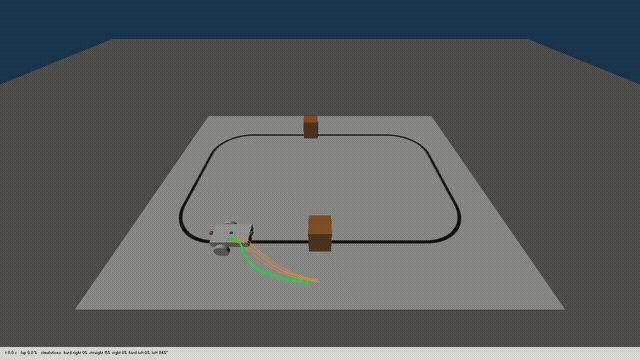

\page bitrl_example_mcts_line_following Following a line with Monte Carlo tree search

bitsim's line_following_infrared_sonar example drives its differential drive robot around a track, a dark line
on light paper with two boxes on it, with a controller written by hand: it follows the line with three infrared
elements, and when its sonar sees a box close ahead, it turns away, drives an arc around the box and finds the
line again. This example drives the same robot around the same track with no such rules. Every 0.2 s it plans
with Monte Carlo tree search (MCTS) and drives with the command the plan starts with.

It needs bitsim built with Chrono, Irrlicht and OpenCV.

## Planning in a model, acting in Chrono

MCTS finds a good action by trying many sequences of actions ahead. It needs an environment that it can copy and
step quickly, from the state the agent is in. The Chrono simulation is neither: one 10 ms step of the robot takes
about 7 ms, and its motors, wheels and sensors keep state that Chrono cannot save and restore. A plan of a few
hundred sequences, each a few seconds long, would take minutes for every decision.

So MCTS plans in a model of the world, and the robot acts in Chrono, the usual way to use MCTS on a robot:

- **The model**, `TrackModel`, is a kinematic robot: a point that moves with the commanded speed and turns with
  the commanded turn rate. It is on the same track, with the same boxes. In it the robot is a circle of
  0.3 m radius around the centre of its chassis, which covers the chassis and the wheels, and it keeps 5 cm more
  from the boxes, for the error of the model.
- **The robot** is bitsim's Chrono robot, with its motors, wheels and caster. It does not do exactly what the
  model predicts: for one, its motors take time to reach a new speed.

Every decision MCTS starts again from where Chrono says the robot is, so the errors of the model do not add up.

## The decisions and the rewards

The robot chooses one of five commands, for the next 0.2 s:

| Command | Speed [m/s] | Turn rate [rad/s] |
| ------- | ----------- | ----------------- |
| straight | 0.3 | 0 |
| turn left | 0.3 | 0.8 |
| turn right | 0.3 | -0.8 |
| turn hard left | 0.2 | 1.6 |
| turn hard right | 0.2 | -1.6 |

The model rewards every step with

- the progress along the track, in metres: the change of the angle of the robot around the centre of the track,
  which goes once around the centre, times the length of the track per radian;
- minus 0.5 for every square metre away from the line and second;
- minus 10 for touching a box, which ends the episode.

## The search

\ref bitrl::rl::algos::mc::MCTSSolver "MCTSSolver" runs 400 simulations for every decision, each looking up to 25
decisions, 5 s, ahead, with \f$\gamma = 0.98\f$. Every simulation copies the model and

1. walks down the tree of the sequences it tried, always to the child with the largest upper confidence bound,
   \f$\bar{G} + c \sqrt{\ln N_{parent} / N}\f$, with \f$c = 0.5\f$, until it reaches a node with a child it has
   not tried;
2. tries that child;
3. goes on with the rollout policy to the end of the 5 s;
4. adds to every node it went through the reward of the step into the node and the discounted return after it.

The robot then drives with the command of the child of the root that the simulations visited most.

The rollout policy matters. With random commands, the rollouts wander, and the returns they give say little about
the node they started from. Worse, a rollout that follows the line drives straight into the next box, so staying on
the line looks worse than driving away from it: in a first version the robot circled at the start. The rollout
policy here, `TowardsTheLine`, does what a simple controller would. It heads along the track and back to the line,
the further from it the more sharply, and when it is within 1 m of a box it heads for a path 0.6 m outside the line
instead, to go around it. A fifth of its commands are random, so that the rollouts try other ways too. The policy
only guides the rollouts: the tree is free to choose other commands where its simulations rate them better.

## The results

|  |
|:--:|
| **The first 20 s at twice real speed, with the camera following the robot. Blue is the path of the robot. At every decision there is a path for each of the five commands: where the model expects the command to lead, along the most visited branch of the tree below it and then the rollout policy, to the end of the 5 s the search looks ahead. Green is the command MCTS chose; the other paths are orange, wider the more of the simulations started with their command.** |

|  |
|:--:|
| **One lap at twice real speed.** |

On one run the robot went once around the track in 47.7 s of simulation, without touching a box, and was never more
than 0.82 m from the line, around the boxes. bitsim's hand written controller takes 59.3 s for the same lap, at the
same top speed. Each decision took about 4 ms of planning on a laptop, so the example runs faster than real time
without a window:

@code{.sh}
./mcts_line_following
@endcode

With `--render` it shows the run in a window, drawn as in the pictures above, with the share of the simulations that
started with each command in the bar at the bottom; the star marks the command MCTS chose. `--follow` shows it with a
camera that follows the robot. `--record DIR` also writes the window to `DIR`, ten frames a second of simulation, and
`--time-limit S` stops after `S` seconds of simulation.

## The driver code

\include mcts_line_following/mcts_line_following.cpp
