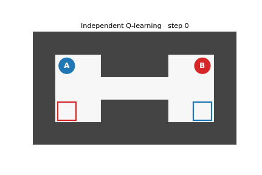

\page bitrl_example_multi_agent_grid_world Independent Q-learning in a corridor

Two agents start in opposite rooms of a grid and each has to reach the far corner of the other
room. The rooms are joined by a corridor one cell wide, so the shortest paths of the two meet in
it, and one agent has to let the other through:

@code
#########
#A.###.B#
#.......#
#b.###.a#
#########
@endcode

`A` goes to `a` and `B` to `b`. This is \ref bitrl::envs::multi_agent::MultiAgentGridWorld
"bitrl::envs::multi_agent::MultiAgentGridWorld", bitrl's first multi-agent environment. Every
step both agents move at once: up, right, down, left or stay. Moves that would put the two in
one cell, or make them swap cells, are cancelled, and the agents that tried to move get a
penalty. Every step costs -0.05, and reaching the goal is worth 1. The example shares the reward:
each agent gets the sum of both rewards, so they win or lose together.

## Multi-agent environments in bitrl

A multi-agent environment derives from \ref bitrl::envs::multi_agent::MultiAgentEnvBase
"MultiAgentEnvBase". Its `step()` takes a *joint action*, one action per agent, and returns a
\ref bitrl::envs::multi_agent::MultiAgentTimeStep "MultiAgentTimeStep" with an observation, a
reward and a done flag for every agent. An agent that is done waits for the others; the episode
ends when all are done, or at the step limit. This is the "parallel" form that PettingZoo also
uses; a turn-based game fits it as well, by ignoring the agents whose turn it is not.

## Independent Q-learning

The simplest way to learn with several agents is to let every agent learn on its own, as if the
others were part of the environment. \ref bitrl::rl::multi_agent::IndependentQLearning
"IndependentQLearning" gives every agent its own Q-table and its own epsilon-greedy policy, and
each agent updates its table from its own observation, action and reward:

\f[
Q_i(o_i, a_i) \leftarrow Q_i(o_i, a_i) + \eta \left[r_i + \gamma \max_{a} Q_i(o'_i, a) - Q_i(o_i, a_i)\right]
\f]

\ref bitrl::rl::multi_agent::MultiAgentTrainer "MultiAgentTrainer" runs the episodes: the team
chooses a joint action, the environment applies it, and the team learns from the transition.

What an agent observes decides what it can learn. With `GridObservation::OWN_POSITION` an agent
knows only its own cell: it cannot tell whether the corridor is free, so whatever path it learns
it takes whether the other agent is in the way or not. With `GridObservation::JOINT_POSITIONS`
its observation is both cells, \f$45 \times 45 = 2025\f$ states, and it can learn to wait.

## Training in parallel

Each training has its own environment and learner, so trainings with different seeds share
nothing, and the example runs all of them at once with `bitsim::utils::concurrency::parallel_map`:

@code{.cpp}
const auto runs = parallel_map(2 * n_seeds, [=](std::size_t k) {
    return train_one(k, n_seeds, n_episodes); // seed task_seed(1, k % n_seeds)
});
@endcode

The results come back in the order of `k`, whatever order the threads finish in, so the output is
the same on any number of threads; the example also trains every team in a plain loop, to time
one thread, and checks that both learned the same. Every agent explores with its own random generator, seeded
with `task_seed()`; a generator shared between threads would be a data race.

## Results

@code
  32 trainings of 4000 episodes in a plain loop: 1.34 s; on the 8 threads of the pool and this one: 0.43 s, a speed-up of 3.09
  every training learned the same in both: true

       observation    solved   mean steps   collisions   final return
      own position         0/16           0.0            11.2           -2.53
   joint positions        16/16          15.2             0.0            0.76
@endcode

Over 16 seeds, no team that sees only its own position learned to cross: their greedy agents
walk into each other in the corridor and stay stuck there until the step limit. Every team that
sees both positions solved it in about 15 steps without a collision: one agent waits in its room
while the other comes through. The speed-up, about 3 over several runs, is smaller than the
number of threads: the laptop has four cores with two threads each, each training takes only about
40 ms, and `parallel_map` hands each thread a chunk of consecutive trainings, so the chunks of the
first half, the teams that see only their own position and often play to the step limit,
take longer than the others.

|  |
|:--:|
| **The greedy team of the first seed that sees both agents. A crosses first while B steps aside and waits; then B follows.** |

The example writes `returns.csv`, the mean team return per episode of both kinds of team, and
`layout.txt` and `episode.csv`, the greedy episode above. `examples/tools/multi_agent_gif.py`
makes the GIF:

@code{.sh}
./multi_agent_grid_world [--episodes 4000] [--seeds 16]
python examples/tools/multi_agent_gif.py grid layout.txt episode.csv --out multi_agent_grid_world.gif
@endcode

## Things to try

1. Turn off `shared_reward`. Does the agent that waits still learn to wait, when waiting costs
   it and helps only the other?
2. Add a third agent with a layout of your own. How many states does a joint observation need
   now, and how much longer does training take?
3. Give the agents a cheaper observation: their own cell and whether the corridor is free.

## The driver code

\include multi_agent_grid_world/multi_agent_grid_world.cpp
