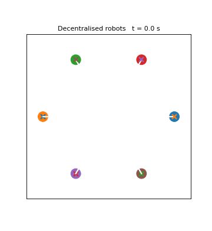

\page bitrl_example_multi_robot_navigation Decentralised robots crossing a circle

Six differential drive robots start evenly spaced on a circle of radius 2 m, and each has to
drive to the point opposite its start. Driven straight, all of them meet in the middle at the
same time. This is \ref bitrl::envs::multi_agent::MultiRobotNavigation
"bitrl::envs::multi_agent::MultiRobotNavigation": each robot is a disc of radius 0.15 m that moves
with the kinematics of bitsim's \ref bitsim::dynamics::DiffDriveDynamics "DiffDriveDynamics",
and its action is a linear and an angular velocity. A move that would make two robots overlap is
cancelled, and the robot stands still for that step.

The robots are *decentralised*: the controller of each robot sees only that robot's observation,
its pose, the vector to its goal, and where the other robots are and how fast they move. Nothing
coordinates them.

## Two controllers

The first controller turns each robot towards its goal and drives, slower when the goal is near
or when it is not facing it. The second adds what each robot sees of the others: it pushes the
heading away from robots closer than 1 m, and a little to the right of them, and slows down when
a robot is close ahead. The push to the right breaks the symmetry: two robots that meet head on
both turn right, and pass each other instead of stopping face to face.

Both are a team in the sense of `run_episode()`, an object with an `act()` that takes the time
step and returns the joint action:

@code{.cpp}
struct Team
{
    const MultiRobotNavigation &env;
    bool avoiding;

    joint_action_type act(const time_step_type &step) const
    {
        joint_action_type actions(step.n_agents());
        for (uint_t i = 0; i < step.n_agents(); ++i)
        {
            const auto &o = step.observation(i); // robot i sees only this
            actions[i] = avoiding ? avoid(o, ...) : go_to_goal(o, ...);
        }
        return actions;
    }
};
@endcode

A team of learners has the same `act()`, so a controller and a learned policy are run the same
way.

## Results

@code
  go to goal: 0 of 6 robots arrived in 60.0 s, 3402 moves blocked by a collision, closest distance between two centres 0.35 m
  avoiding: 6 of 6 robots arrived in 11.0 s, 0 moves blocked by a collision, closest distance between two centres 0.55 m
@endcode

Straight to the goal, the six robots jam in the middle and none arrives before the time limit.
Steering around each other, they form a roundabout and all arrive in 11 s, never closer than
0.55 m centre to centre, against 0.3 m at contact.

|  |
|:--:|
| **Six robots with the avoiding controller. The crosses are the goals.** |

## Many simulations in parallel

The last part runs both controllers with 2 to 12 robots, from 10 starts each, shifted at random
by a few centimetres: 120 simulations. They share nothing, so `parallel_map` runs them at the same
time on all the threads, and returns them in order:

@code
  robots   controller   all arrived   mean time [s]   blocked moves
       2      to goal          0/10               -          1127.4
       2     avoiding         10/10             9.7             0.0
       6      to goal          0/10               -          3401.7
       6     avoiding         10/10            11.0             0.0
      12      to goal          0/10               -          6861.2
      12     avoiding         10/10            14.3             0.0
@endcode

Even two robots jam with the first controller: the small shifts of the starts are not enough to
break the symmetry. The avoiding controller gets every robot through from every start, and the
crossing takes longer the more robots share the middle.

The example writes `trajectories.csv`, every robot at every step of the avoiding run, and
`examples/tools/multi_agent_gif.py` makes the GIF:

@code{.sh}
./multi_robot_navigation [--robots 6]
python examples/tools/multi_agent_gif.py robots trajectories.csv --out multi_robot_navigation.gif
@endcode

## Things to try

1. Push to the left instead of to the right for half of the robots. What happens when two robots
   that meet disagree?
2. Make one robot ignore the others. Can the rest still get through?
3. The environment gives every robot a reward: progress to the goal, a cost per step and a
   penalty for collisions. Train a policy on it instead of writing the controller.

## The driver code

\include multi_robot_navigation/multi_robot_navigation.cpp
