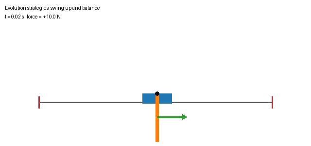

\page bitrl_example_es_cart_pole_swing_up Swinging a pole up with evolution strategies

The pole of a cart-pole hangs down, and the cart has to swing it up and then balance it on top.
No push of 10 N lifts the pole at once: the cart has to rock back and forth to pump energy into
the swing, catch the pole as it goes over the top, and hold it there, all within 2.4 m of the
centre. The force can take any value in [-10, 10] N.

Here an *evolution strategy* learns to do that. It never computes a gradient of the policy: it
tries small random changes of the policy's weights, plays an episode with each, and moves the
weights towards the changes that did better. The episodes of a generation do not depend on each
other, so they all run at the same time, on all the threads.

## What you need

Nothing beyond bitrl. The task is
\ref bitrl::envs::classic_control::CartPoleSwingUp "CartPoleSwingUp", simulated in the example's own
process with bitsim's cart-pole dynamics, and the policy is an
\ref bitrl::rl::algos::es::MLPPolicy "MLPPolicy", a small network that needs no libtorch.

## The task

\ref bitrl::envs::classic_control::CartPoleSwingUp "CartPoleSwingUp" is the cart and the pole of
\ref bitrl::envs::classic_control::CartPole "CartPole", with the pole hanging down at the start. The
observation is \f$[x, \dot x, \sin\theta, \cos\theta, \dot\theta]\f$, with \f$\theta\f$ from upright,
and the action is the force on the cart. Every step of 0.02 s is worth
\f$(1 + \cos\theta)/2 - 0.02 x^2\f$: 0 for a pole hanging down, 1 for a pole up with the cart at the
centre. Leaving the track costs 100 and ends the episode, so the best return over the 500 steps of
an episode, 10 s, is a little over 450: the swing up takes time.

## The evolution strategy

\ref bitrl::rl::algos::es::EvolutionStrategy "EvolutionStrategy" is the method of Salimans et al.
(2017). Its state is one set of parameters \f$\theta\f$, here the 113 weights of a network with 16
tanh units. Every generation it draws 32 directions \f$\epsilon_k\f$ of standard normal noise, and
plays one episode at \f$\theta + \sigma\epsilon_k\f$ and one at \f$\theta - \sigma\epsilon_k\f$, with
\f$\sigma = 0.1\f$: 64 episodes. Their returns are replaced by their ranks, from -0.5 for the worst to
0.5 for the best, and

\f[
g = \frac{1}{2 n \sigma} \sum_{k=1}^{n} \left(F(\theta + \sigma\epsilon_k) - F(\theta - \sigma\epsilon_k)\right) \epsilon_k
\f]

estimates the direction in which the return grows. Adam takes a step along it. The fitness is any
function of the parameters:

@code{.cpp}
const MLPPolicy net({5, 16, 1});
auto fitness = [&](const std::vector<real_t> &p, uint_t generation, uint_t pair) {
    CartPoleSwingUp env;                              // every episode its own environment
    env.make("v1", {{"max_steps", uint_t(500)}}, {});
    auto act = [&](const std::vector<real_t> &obs) { return net.act_continuous(p, scaled(obs), 10.0); };
    return episode_return(env, act, task_seed(generation, pair), 500);
};

EvolutionStrategy es(config, initial_parameters);
for (uint_t g = 0; g < 1500; ++g)
    es.step(fitness);                                 // 64 episodes, on all the threads
@endcode

Both episodes of a pair start from the same state, seeded with the generation and the pair, so
the difference of their returns comes from the change of the weights, not from the luck of the
start. The ranks make the method blind to how far apart the returns are, so a few episodes that
end off the track, at -100, do not swamp the others. Equal returns share their rank and so point
nowhere.

## Many threads, the same result

`step()` plays the 64 episodes on the threads of bitsim's pool. The noise of pair \f$k\f$ in
generation \f$g\f$ is drawn from its own seed, `task_seed(task_seed(seed, g), k)`, and the gradient
adds the pairs in their order, so the result does not depend on the number of threads, nor on which
thread plays which episode. The example checks that by training again on one thread.

## Running the example

@code{.sh}
./es_cart_pole_swing_up [--generations 1500] [--csv swing_up.csv]
python examples/tools/cart_pole_gif.py swing_up.csv --out es_cart_pole_swing_up.gif
@endcode

## Output

@code
1. Learning to swing up, 1500 generations of 64 episodes, on 9 threads
   the policy has 113 parameters

   generation   mean return   best return   return of the mean
            0         -84.4          16.9               -104.4
          250         261.5         309.7                288.7
          500         326.1         356.5                351.5
          750         297.5         448.7                448.5
         1000         392.2         451.7                449.9
         1250         413.9         452.0                452.1
         1499         409.2         452.1                451.8
   in 13.1 s

2. The first 50 generations again, on one thread
   1.35 s against 0.42 s on 9 threads, a speed-up of 3.22
   the same parameters, to the last bit: true

3. The learned policy, from 20 starts it never trained on
   start   return   up after [s]   up in the last 5 s   furthest from the centre [m]
       0    451.7           1.46                100 %                          0.68
       1    452.3           1.46                100 %                          0.64
       2    452.4           1.46                100 %                          0.63
       3    452.4           1.46                100 %                          0.62
       4    451.1           1.46                100 %                          0.70
   ...
   up for the whole of the last 5 s from 20 of 20 starts; up 100 % of that time on average
@endcode

At first most episodes run off the track, at -100. The return of the mean policy passes 440 after
about 750 generations, when it learns to catch the pole at the top. In the end it swings the pole
up in under 1.5 s and holds it up for the whole of the last 5 s from all 20 starts; the five shown
never take the cart further than 0.7 m from the centre. The mean return of a generation stays below the return of the mean policy, \f$\theta\f$
itself: the perturbed policies are noisier than the policy they perturb.

The episodes are short, a few hundred microseconds, so handing them to the threads costs a good part
of what the threads save: 9 threads play them only 3.2 times faster. Episodes that take longer, a
physics engine or a policy with more weights, gain more.

## Things to try

1. Set `rank_shaping` to false, so that the returns are used as they are. Does it still learn?
2. Halve `sigma`, and double it. What happens to the generations it takes?
3. Use 8 pairs per generation instead of 32, and 4 times as many generations. Which learns in less
   time?

## The code

\include es_cart_pole_swing_up.cpp
